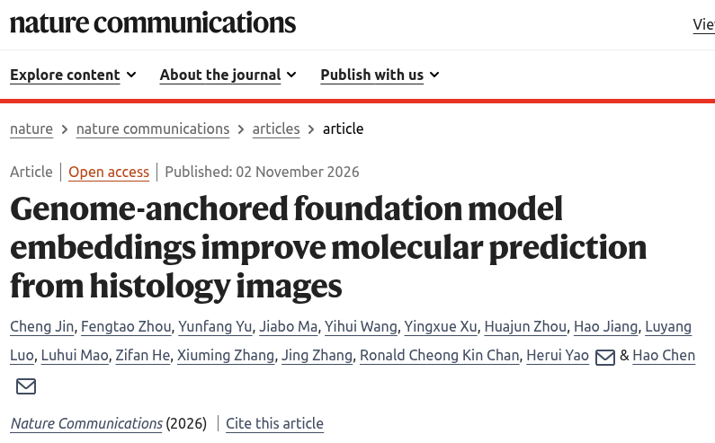
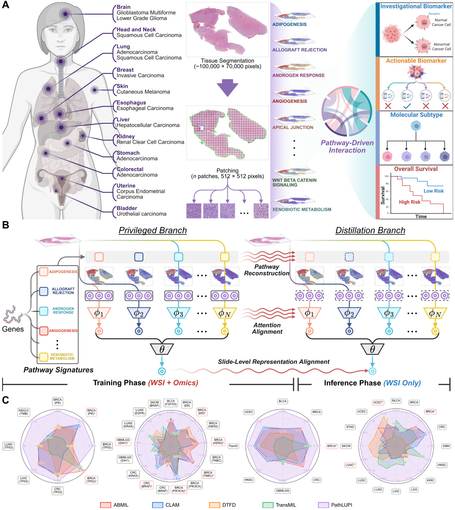
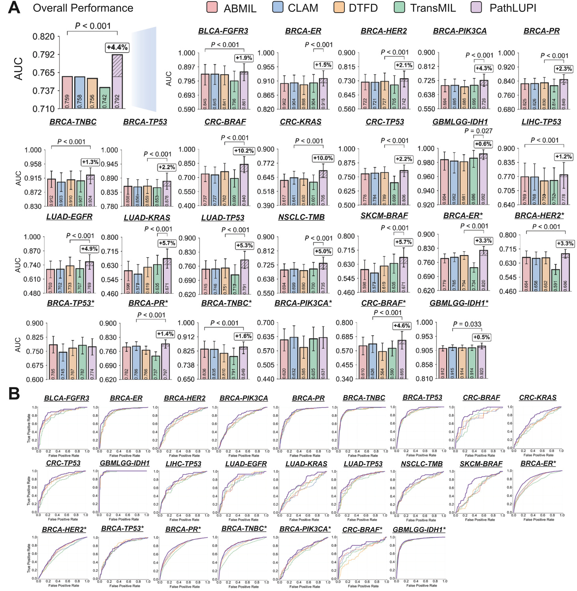
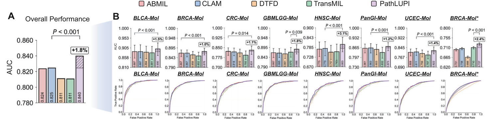
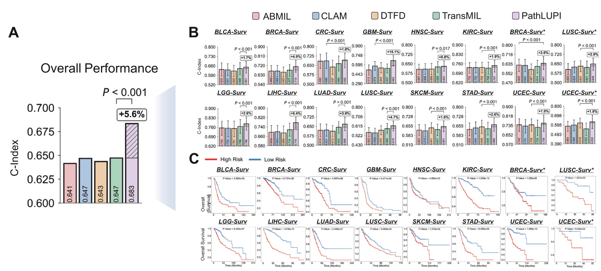
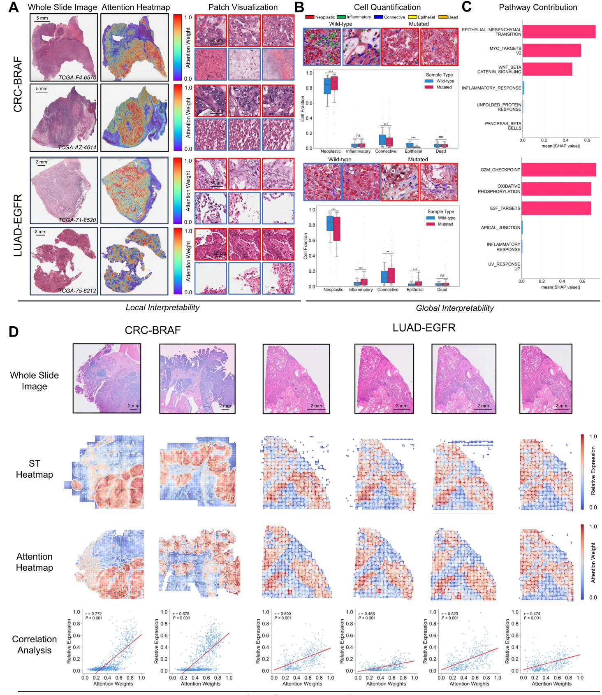

Researchers led by Professor Hao Chen at the Hong Kong University of Science and Technology have developed **PathLUPI** for molecular prediction from routine pathology images. The study was conducted in collaboration with Professor Herui Yao at Sun Yat-sen Memorial Hospital, Sun Yat-sen University. The work was published in *Nature Communications* on 2 November 2026.

Molecular profiling informs cancer diagnosis, treatment selection and prognosis, but its cost and turnaround time can limit access. Routine haematoxylin and eosin (H&E) slides contain morphological clues to tumour biology. However, models trained on images alone can struggle to detect the subtle patterns associated with specific molecular alterations.

PathLUPI uses **transcriptomic information as privileged supervision during training** to learn histological representations linked to molecular pathways. The trained model requires **only whole-slide images (WSIs) at inference**, allowing it to make predictions without a new patient's transcriptomic profile.

Evaluation covered **49 molecular oncology tasks, 11,361 patients, 20 cohorts and 13 cancer types**. PathLUPI achieved an area under the receiver operating characteristic curve (AUC) of at least 0.80 on 18 biomarker prediction and molecular subtyping tasks. Survival prediction reached a concordance index (C-index) of at least 0.70 in cohorts spanning five major cancer types. Analyses of model attention further linked predictions to recognizable tissue structures and spatially measured pathway activity.

**Figure 1 | Overview of PathLUPI.** **A,** Study scope across 13 cancer types and four categories of molecular oncology tasks. **B,** Transcriptomic pathway signatures guide representation learning during training, while inference uses histology alone. **C,** Comparison with four WSI-only baselines across 49 tasks. Original figure from Jin et al.; schematic created in BioRender by Zhou, F. (2026), [BioRender.com/siqgawq](https://BioRender.com/siqgawq).

## Introduction

Tumours with similar histological appearances can have different molecular characteristics, treatment options and clinical outcomes. Molecular assays help distinguish these differences, complementing the tissue assessment provided by routine pathological examination.

Computational pathology seeks to infer some of these characteristics directly from digitized H&E slides. Pathology foundation models extract rich visual features, but those features may not capture the molecular differences relevant to a particular prediction task.

PathLUPI applies the learning using privileged information (LUPI) paradigm to this problem. Paired transcriptomic profiles guide the model towards molecularly informative tissue features during training. This guidance is transferred to an image-only branch that can operate independently when molecular measurements are unavailable.

## Background

Histology-based molecular prediction faces several connected barriers:

* **Molecular signals can be visually subtle.** Alterations such as BRAF, KRAS and PIK3CA may be difficult to infer from morphology alone.
* **Visual features may lack molecular specificity.** Pathology encoders do not necessarily organize their representations around the pathways relevant to a prediction task.
* **Molecular inputs may be unavailable at deployment.** Models that require paired images and molecular profiles depend on access to both modalities for each patient.
* **Performance can shift between cohorts.** Differences in institutions, specimen types and acquisition conditions challenge generalization.

These challenges motivate a training strategy that incorporates molecular guidance while preserving image-only inference.

## Method

### Anchoring histology features to molecular pathways

The researchers used paired WSIs and bulk RNA-sequencing profiles from 6,427 patients in The Cancer Genome Atlas (TCGA), covering 13 cancer types. Gene-expression features were grouped using Hallmark gene sets, allowing the model to learn from coordinated pathway activity.

The main implementation uses a frozen CONCH pathology foundation model to extract morphological features. PathLUPI learns to aggregate these features into genome-anchored slide representations through transcriptomic guidance. This learning takes place downstream of the image encoder, whose parameters remain fixed.

### Transferring molecular context to an image-only branch

PathLUPI has two branches during training:

* **Privileged branch:** combines WSI features with paired, pathway-grouped transcriptomic features through cross-attention.
* **Distillation branch:** receives WSI features alone, reconstructs a simulated transcriptomic representation and combines it with morphological features through the shared cross-attention mechanism.

Training aligns the branches at three levels: transcriptomic reconstruction, attention patterns and slide-level representations. These objectives encourage the distillation branch to retain molecular context using only image features.

Only the distillation branch is active at inference, producing embeddings for biomarker prediction, molecular subtyping and survival-risk estimation.

## Improved Biomarker Prediction

The study assessed 25 biomarker prediction tasks, comprising eight investigational and 17 actionable biomarker tasks. PathLUPI was compared with four WSI-only methods: ABMIL, CLAM, DTFD and TransMIL.

PathLUPI achieved an internal mean AUC of **0.804**, a **4.83% relative improvement** over the strongest comparator, DTFD. External validation showed a **2.40% relative improvement** over ABMIL, the strongest comparator in those cohorts. Both aggregate comparisons were statistically significant (P < 0.001).

For BRAF mutation prediction in colorectal cancer, PathLUPI achieved an internal AUC of **0.840** and an external AUC of **0.655**. For KRAS mutation prediction, the internal AUC reached **0.705**. IDH1 mutation prediction in gliomas achieved AUCs of **0.992 internally** and **0.920 externally**, with external performance comparable to CLAM.

Performance varied across biomarkers and cohorts, with smaller advantages for some external tasks. PIK3CA mutation prediction in breast cancer reached an internal AUC of 0.726 and an external AUC of 0.631. The external result was comparable to the best baseline, indicating that gains did not transfer equally across all targets.

**Figure 2 | Biomarker prediction across 25 tasks.** **A,** AUC comparisons between PathLUPI and four WSI-only baselines. **B,** Receiver operating characteristic curves for individual tasks. Asterisks identify external cohorts; error bars show 95% confidence intervals.

## Molecular Subtyping and Survival Prognosis

Molecular subtyping groups tumours by broader molecular profiles rather than individual alterations. Across eight subtyping tasks, PathLUPI achieved mean AUCs of **0.856 internally** and **0.727 externally**. These corresponded to relative improvements of 1.47% and 2.40% over the strongest comparators, respectively (both P < 0.001).

**Figure 3 | Molecular subtyping across eight tasks.** **A,** Overall mean AUC for each method. **B,** Task-level AUC comparisons and receiver operating characteristic curves, including external validation.

The researchers assessed survival prognosis across a further 16 prediction tasks. PathLUPI achieved an internal mean C-index of **0.693**, a **5.19% relative improvement** over TransMIL. C-indices reached 0.710 for breast cancer, 0.786 for lower-grade glioma and 0.776 for hepatocellular carcinoma. Scores were 0.747 for kidney renal clear cell carcinoma and 0.756 for uterine corpus endometrial carcinoma.

Across three external survival cohorts, PathLUPI achieved a mean C-index of **0.640**, compared with **0.613** for CLAM, the strongest baseline. Kaplan–Meier analyses showed separation between the predicted high-risk and low-risk patient groups.

**Figure 4 | Survival prognosis across 16 tasks.** **A,** Overall C-index comparisons. **B,** Cohort-level prognostic performance. **C,** Kaplan–Meier curves for high-risk and low-risk groups predicted by PathLUPI.

## External Validation Across Institutions and Specimen Types

External evaluation included **4,934 patients from seven independent cohorts**, covering public datasets and clinical collections. Surgical resection specimens came from the First Affiliated Hospital of Zhejiang University School of Medicine, and core-needle biopsies came from Sun Yat-sen Memorial Hospital. Public cohorts included the Clinical Proteomic Tumor Analysis Consortium (CPTAC) and the EBRAINS Digital Tumor Atlas.

Including both resections and biopsies tested generalization across specimen types as well as institutions. In the biopsy cohort, unsupervised test-time adaptation helped recover performance lost under specimen-level domain shift. These results indicate that the representations can be adapted across settings, although performance remains sensitive to differences between training and deployment data.

Additional experiments evaluated PathLUPI with alternative pathology encoders, including PLIP, UNI, CONCH-1.5, Virchow and Hibou-L. No encoder performed best on every task, showing that encoder choice remains important alongside transcriptomic supervision.

## Connecting Predictions to Tissue Biology

The researchers examined model attention to understand which tissue features contributed to predictions. In BRAF-mutated colorectal cancer, high-attention regions showed mucinous differentiation and serrated glandular structures. In EGFR-mutated lung adenocarcinoma, these regions included micropapillary and lepidic growth patterns.

Cellular-composition analysis characterized the cells within high-attention regions, while pathway attribution identified molecular pathways associated with the predictions. Influential pathways included MYC_TARGETS_V2 in BRAF-mutated colorectal cancer and G2M_CHECKPOINT in EGFR-mutated lung adenocarcinoma.

Independent high-resolution spatial transcriptomics samples allowed the researchers to compare model attention with measured pathway activity. The two showed a **mean Pearson correlation of 0.57** in the representative validation samples. This provides initial evidence that model attention can localize molecularly associated tissue patterns, although validation was limited to a small set of samples.

**Figure 5 | Linking model predictions with tissue morphology and molecular pathways.** **A,** Attention heatmaps and representative histological regions. **B,** Cellular composition of high-attention patches. **C,** Pathway contributions estimated with Shapley values. **D,** Comparison of model attention with pathway activity measured by Visium HD spatial transcriptomics.

## Translational Potential

The study contributes three advances to histology-based molecular prediction:

* **Molecular guidance without molecular inputs at inference.** Transcriptomic supervision helps the model learn informative tissue features while preserving a histology-only prediction workflow.
* **Evaluation across multiple oncology tasks.** The 49-task benchmark assesses biomarker prediction, molecular subtyping and survival prognosis, with external cohorts testing cross-source generalization.
* **Links between predictions and tissue biology.** Attention maps, cellular analysis and pathway attribution associate predictions with specific tissue structures and molecular patterns.

Several limitations define the current scope of the work. Training requires paired histology and transcriptomic data, and several actionable biomarkers still lack independent external validation. Spatial transcriptomics analyses provide initial biological support but require confirmation in larger sample sets. Prospective studies and probability calibration in target populations are needed to establish performance requirements for specific clinical workflows.

PathLUPI shows how molecular measurements collected during training can improve predictions from routine pathology images. The framework supports further investigation of histology-based molecular screening and risk stratification, with clinical utility to be established through prospective evaluation.

---

## Resources

**Paper |** *Genome-anchored foundation model embeddings improve molecular prediction from histology images*

**Journal |** *Nature Communications*

**Publication date |** 2 November 2026 (advance online publication; article in press)

**Official article |** [https://www.nature.com/articles/s41467-026-78947-2](https://www.nature.com/articles/s41467-026-78947-2)

**DOI |** [https://doi.org/10.1038/s41467-026-78947-2](https://doi.org/10.1038/s41467-026-78947-2)

**Paper PDF |** [Publisher PDF](https://www.nature.com/articles/s41467-026-78947-2_reference.pdf)

**Code |** [https://github.com/ChengJin-git/PathLUPI](https://github.com/ChengJin-git/PathLUPI)

**Joint first authors |** Cheng Jin, Fengtao Zhou and Yunfang Yu

**Corresponding authors |** Herui Yao, Sun Yat-sen Memorial Hospital, Sun Yat-sen University; yaoherui@mail.sysu.edu.cn. Hao Chen, The Hong Kong University of Science and Technology; jhc@ust.hk.

**Collaborating institutions |** The Hong Kong University of Science and Technology; Sun Yat-sen Memorial Hospital, Sun Yat-sen University, including Shenshan Medical Center; Macau University of Science and Technology; The First Affiliated Hospital, Jinan University; Harvard University; The First Affiliated Hospital, School of Medicine, Zhejiang University; The Chinese University of Hong Kong; HKUST Shenzhen–Hong Kong Collaborative Innovation Research Institute.
